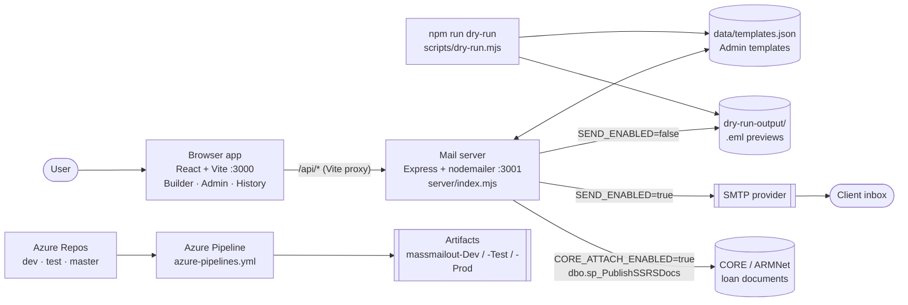

<!--
AIT-TBC | README.md | Ramesh Konda | 2026-10-28 | Project summary: functionality, architecture, configuration and pipeline
Change log:
  2026-10-28 RK AIT-TBC Initial version
  2026-10-28 RK AIT-TBC Rewritten as the full project summary (replaces the AI Studio boilerplate)
  2026-10-28 RK AIT-TBC Per-environment config (config/dev|test|prod.env, APP_ENV, SEND_ALLOWLIST)
-->

# MassMailer Pro (Mass Mailout)

MassMailer Pro sends personalised bulk email campaigns to clients from a CSV list. Each email can carry several attachments and a branded HTML design, and can be saved against the client's loan in CORE (ARMNet) as an audit record.

Everything is **safe by default**. Until real sending is switched on, every "send" is a dry run that builds the exact email, attachments included, as a `.eml` file you can open in Outlook. Saving to CORE has its own off switch, a write-nothing dry-run mode, and a guard that refuses production databases.

**Main features**

- **Five-step campaign builder**: basic info, recipients (CSV), template, attachments, review.
- **Personalised merge tags** taken from any CSV column, in the subject, body, header and footer.
- **Admin email templates**: reusable CSS, header and footer, with a live preview.
- **HTML email** with a plain-text fallback. The CSS is inlined so Outlook and Gmail keep the styling.
- **Multiple attachments** per email.
- **Dry run and `.eml` previews**, both from the app and from the command line.
- **Live sending through SMTP**, with confirmations, throttling and a start-up login check.
- **CORE integration**: each sent email (`.eml`) is saved to the loan's documents through `dbo.sp_PublishSSRSDocs`.
- **History** of every email and its outcome: sent, dry run or failed, plus its CORE save status.
- **Optional Gemini voice assistant** that fills in the campaign or launches it on request. A Gemini drafting helper exists in `services/`, but the UI doesn't use it yet.
- **Azure DevOps pipeline** that builds and tests the `dev`, `test` and `master` branches.

## Architecture



The app, the mail server and the dry-run script all render emails with the same code (`shared/emailRender.mjs`). So the Review preview, the dry-run `.eml` and the email the client receives are identical.

## How a campaign flows

1. **Basic info.** Name the campaign.
2. **Recipients.** Upload a CSV. It needs an email column (any header containing "email"), plus any other columns you want to merge, for example `Loanid`, `Clientname` or `LoanGUID`. Rows with an invalid or duplicate email are skipped, and you're told how many. Quoted fields such as `"Acme, Inc."` are handled.
3. **Template.** Write the subject and body. Pick a design template from Admin, or none, and tick **Body is HTML** if the body contains HTML. Merge-tag buttons insert the CSV columns for you.
4. **Attachments.** Add any number of files. Every recipient gets the same attachments.
5. **Review.** Check the personalised preview for the first recipient. A banner shows the mode: **Dry run** (amber), **LIVE** (red), or mail server not running. Use **Test Send** for the first recipient only, or **Launch** for all of them.
6. **Sending.** For each recipient the app posts to `/api/send`. The mail server builds the MIME email and does one of the following:
   - In a dry run, saves it as a `.eml`.
   - In live mode, sends it through SMTP, keeping at least `SEND_DELAY_MS` between sends.
   - If CORE saving is on, then saves the `.eml` to the loan in CORE.
7. **History.** Each email shows its status (sent, dry run or failed), its CORE result, and a **preview .eml** download link for dry runs.

## Merge tags

Write tags as `{{column}}` or `@Field(column)`. Both take the value from the CSV column of that name, matched case-insensitively, so `{{clientname}}` matches a `Clientname` column. Tags work in the subject, body, template header and template footer. In HTML, merged values are escaped so that characters like `<` or `&` in the CSV can't break the layout.

Unknown tags are left as written, so they stand out in previews. The command-line dry run also lists unresolved tags and blank values. There are no ARMNet numeric field codes: every tag is a CSV column name.

## Admin: email templates

Click **Admin** in the header to create, edit and delete reusable designs. Each template has:

- **Styles (CSS)**, for example `body { font-family: calibri, arial, sans-serif; }`
- **Header (HTML)**, for example a logo
- **Footer (HTML)**, for example "Regards," and a footer banner image

A live preview updates as you type. Templates are stored by the mail server in `data/templates.json`, which git ignores; change the path with `TEMPLATES_FILE`. When an email is built, its CSS is inlined into each element (juice) and a plain-text version is added. Images must use public `https://` URLs.

## Dry run and `.eml` previews

While `SEND_ENABLED` is not `true`, nothing is sent. The mail server builds each email exactly as it would send it and saves it as `dry-run-output/<campaign>_<timestamp>/NNNN_<email>.eml`; change the folder with `DRY_RUN_DIR`. Download one from History and double-click it to open it in Outlook or Mail.

Without the app, use the command line:

```
npm run dry-run -- <recipients.csv> <campaign.json> [outDir]
```

This writes `emails.json`, `emails.csv`, `preview.html` and one `.eml` per recipient in `eml/`. It flags invalid or duplicate rows, unresolved tags and blank values. Fields in `campaign.json`:

| Field | Meaning |
|---|---|
| `name`, `subject`, `body` | Campaign name, subject and body, with merge tags |
| `attachments` | File paths, relative to the JSON file or absolute |
| `template` | Optional: an Admin template name or id |
| `bodyIsHtml` | Optional: `true` if `body` is HTML |
| `from` | Optional: overrides `MAIL_FROM` |

Examples are `samples/campaign.json` (plain text, two attachments) and `samples/campaign-html.json` (HTML template).

## Live sending and safeguards

Set `SEND_ENABLED=true` in `.env.local`, then restart `npm run server`. The safeguards:

- At start-up the server refuses to run if SMTP settings are missing or `MAIL_FROM` has no email address, then checks the SMTP login.
- The Review step shows a red **LIVE** banner. **Launch** and **Test Send** both ask you to confirm the number of recipients and the From address.
- Invalid recipients are rejected, and sends are throttled to at least `SEND_DELAY_MS` apart (default 1000 ms).
- Each email's result is recorded in History, and a failure doesn't stop the rest of the batch.

For Gmail or Google Workspace, use an [App Password](https://myaccount.google.com/apppasswords) as `SMTP_PASS`.

## Saving sent emails to the loan in CORE

When `CORE_ATTACH_ENABLED=true`, each sent email is saved to the loan's documents in CORE (ARMNet). The mail server calls `dbo.sp_PublishSSRSDocs`, the same procedure the TransmitSMS CLR uses for SMS records. It runs on its own connection, outside any transaction, with these parameters:

| Parameter | Value |
|---|---|
| `@ownerGUID` | The loan GUID, from the CSV column `CORE_LOANGUID_COLUMN` (default `LoanGUID`) or, if there isn't one, from `CORE_LOANGUID_LOOKUP_SQL`, a SELECT that takes `@LoanID` (read from `CORE_LOANID_COLUMN`, default `Loanid`) and returns the GUID |
| `@documentName` | `CORE_DOC_TITLE` (default `{{Loanid}} - {{Clientname}}`) + ` dd-MM-yyyy HHmmss.eml`, for example `560246 - Ramesh Konda 28-10-2026 104512.eml` |
| `@base64Doc` | The exact `.eml` the client received, attachments included, base64-encoded |
| `@createdBy` | `CORE_CREATED_BY`, or else the `DOMAIN\username` running the mail server, or else `MassMailout` |

Safety switches:

- **`CORE_DB_DRYRUN=true`** (the default) writes nothing. The log and History show the document name and loan GUID that would be used.
- **Prod guard.** A server or database name containing "prod" is refused unless `CORE_ALLOW_PROD=true`. At start-up the server also checks that the procedure exists.
- **Real sends only.** Dry-run emails are saved only if `CORE_ATTACH_DRYRUNS=true`, which is meant for UAT.
- **No rollback.** A CORE failure never undoes a send. It's shown against that email in History.
- **Authentication.** `CORE_DB_AUTH=windows` uses integrated security and needs ODBC Driver 17 or 18 plus `msnodesqlv8`. `CORE_DB_AUTH=sql` uses `CORE_DB_USER` and `CORE_DB_PASSWORD`.

## Repository layout

| Path | Purpose |
|---|---|
| `App.tsx` | Main React app: campaign builder, Review, History and the Gemini voice assistant |
| `components/CampaignSteps.tsx` | Step indicator for the builder |
| `components/TemplateAdmin.tsx` | Admin page: template editor with live preview |
| `services/geminiService.ts` | Gemini helper that drafts a subject and body from a campaign goal (the UI doesn't use it yet) |
| `utils/csv.ts` | RFC 4180 CSV parser used for uploads |
| `types.ts` | Shared TypeScript types |
| `shared/emailRender.mjs` | Merge tags and HTML rendering, shared by the app, the server and the dry run |
| `server/index.mjs` | Mail server (Express): `/api/status`, `/api/send`, `/api/templates`, `/api/preview` |
| `server/mail.mjs` | Builds MIME messages and `.eml` files (nodemailer), CSS inlining, `.env.local` loader |
| `server/templates.mjs` | Template store (`data/templates.json`) |
| `server/core.mjs` | CORE connector: `sp_PublishSSRSDocs`, loan GUID lookup, prod guard |
| `scripts/dry-run.mjs` | Command-line dry run that writes `.eml` files and `preview.html` |
| `scripts/smoke-test.mjs` | Mail server smoke test, used by the pipeline; always runs in dry-run mode |
| `samples/` | Example recipients CSV, campaigns and attachments |
| `azure-pipelines.yml` | Azure DevOps build pipeline |
| `.env.example` | All settings, documented. Copy it to `.env.local` |
| `vite.config.ts`, `index.html`, `index.tsx` | Web app build and entry point. `/api` is proxied to the mail server |

These are not in git: `.env.local`, which holds secrets; `data/`, which holds the templates; `dry-run-output/`; `dist/`; and `node_modules/`.

## Environments (dev, test, prod)

Settings come from three layers. The highest one wins:

| Layer | What goes there | In git? |
|---|---|---|
| Real environment variables | Pipeline or service variables, e.g. secret variable groups | No |
| `.env.local` on the machine | `APP_ENV` and the secrets (`SMTP_USER`, `SMTP_PASS`, `CORE_DB_USER`, `CORE_DB_PASSWORD`, `GEMINI_API_KEY`), plus any local overrides | No |
| `config/<APP_ENV>.env` | Every non-secret setting for that environment: SMTP host, From address, allow-list, CORE server and database, safety switches | Yes |

`APP_ENV` is `dev`, `test` or `prod`, and defaults to `dev`. The pipeline maps it from the branch automatically: `dev` → `dev`, `test` → `test`, `master` → `prod`. It stamps `config/active-env` into each build artifact, so a deployed build starts in the right environment without any manual setting. The app header shows the environment as a DEV, TEST or PROD badge, and `/api/status` reports it.

Per-environment safety:
- **Dev and test** can only send live email to `SEND_ALLOWLIST`, for example `@iqeq.com,@amal.com.au`. The server won't start in live mode there without an allow-list.
- **A production database** (any name containing "prod") is refused unless `APP_ENV=prod` **and** `CORE_ALLOW_PROD=true`.
- **No secrets in config files.** `npm run check-config`, which also runs in the pipeline, fails the build if any secret appears in a config file, if a setting is unknown, or if a non-prod file allows prod or sends without an allow-list.

To go live in an environment, fill in its `TBC` values in `config/<env>.env` (From address, SMTP host, CORE server and database), then switch on `SEND_ENABLED`, `CORE_ATTACH_ENABLED` and `CORE_DB_DRYRUN=false` in a reviewed commit to that branch.

## Configuration (all settings)

Copy `.env.example` to `.env.local` and set `APP_ENV` and the secrets. Never commit `.env.local`. Everything else comes from `config/<APP_ENV>.env`. Uncomment a setting in `.env.local` only to override it on that machine. The mail server reads its settings only at start-up, so restart `npm run server` after any change.

| Setting | Default | Purpose |
|---|---|---|
| `APP_ENV` | `dev` | `dev`, `test` or `prod`. Picks `config/<APP_ENV>.env` |
| `SEND_ALLOWLIST` | dev/test: `@iqeq.com,@amal.com.au`; prod: (blank) | Live sends only to these addresses or @domains. Blank means anyone |

**App**

| Setting | Default | Purpose |
|---|---|---|
| `GEMINI_API_KEY` | (blank) | Turns on the Gemini voice assistant |

**Mail server**

| Setting | Default | Purpose |
|---|---|---|
| `SEND_ENABLED` | `false` | `true` sends real email. Anything else is a dry run |
| `SMTP_HOST`, `SMTP_PORT`, `SMTP_SECURE` | `smtp.gmail.com`, `587`, `false` | SMTP server. Use `SMTP_SECURE=true` for port 465 |
| `SMTP_USER`, `SMTP_PASS` | (blank) | SMTP login |
| `MAIL_FROM` | `Your Name <you@example.com>` | From line. Must include an email address |
| `SEND_DELAY_MS` | `1000` | Minimum milliseconds between live sends |
| `MAIL_SERVER_PORT` | `3001` | Mail server port. Vite proxies `/api` here |
| `DRY_RUN_DIR` | `dry-run-output` | Where dry-run `.eml` files are saved |
| `TEMPLATES_FILE` | `data/templates.json` | Where Admin templates are stored |

**CORE connector**

| Setting | Default | Purpose |
|---|---|---|
| `CORE_ATTACH_ENABLED` | `false` | Master switch for saving emails to CORE |
| `CORE_DB_SERVER`, `CORE_DB_NAME` | (blank) | SQL Server instance and ARMNet database |
| `CORE_DB_AUTH` | `windows` | `windows` (integrated security) or `sql` |
| `CORE_DB_ODBC_DRIVER` | `ODBC Driver 17 for SQL Server` | ODBC driver for Windows authentication |
| `CORE_DB_USER`, `CORE_DB_PASSWORD` | (blank) | SQL login, when `CORE_DB_AUTH=sql` |
| `CORE_DB_ENCRYPT`, `CORE_DB_TRUST_CERT` | `true`, `true` | Connection encryption and certificate trust |
| `CORE_DB_DRYRUN` | `true` | `true` writes nothing and only reports what would be saved |
| `CORE_ATTACH_DRYRUNS` | `false` | Also save dry-run emails (UAT only) |
| `CORE_ALLOW_PROD` | `false` | Allow server or database names containing "prod" |
| `CORE_PUBLISH_PROC` | `dbo.sp_PublishSSRSDocs` | Procedure that stores the document |
| `CORE_LOANGUID_COLUMN` | `LoanGUID` | CSV column holding the loan GUID |
| `CORE_LOANID_COLUMN` | `Loanid` | CSV column holding the loan ID, used by the lookup |
| `CORE_LOANGUID_LOOKUP_SQL` | (blank) | SELECT taking `@LoanID` and returning the GUID, used when the CSV has no GUID column |
| `CORE_DOC_TITLE` | `{{Loanid}} - {{Clientname}}` | Document name, before the timestamp and `.eml` |
| `CORE_CREATED_BY` | `DOMAIN\username`, else `MassMailout` | Value for `@createdBy` |

## Running locally

Prerequisites: Node.js 18 or later (CI uses 22), and Windows with ODBC Driver 17 or 18 if you use CORE with Windows authentication.

```
npm install
copy .env.example .env.local      # then edit it; leave SEND_ENABLED=false to start
npm run server                    # terminal 1: mail server on :3001
npm run dev                       # terminal 2: app on http://localhost:3000
```

| Script | What it does |
|---|---|
| `npm run dev` | Starts the web app (Vite) on port 3000 |
| `npm run server` | Starts the mail server on port 3001 |
| `npm run build` | Builds the production web app into `dist/` |
| `npm run preview` | Serves the built app |
| `npm run typecheck` | TypeScript check (`tsc --noEmit`) |
| `npm run dry-run -- <csv> <campaign.json> [outDir]` | Command-line dry run that writes `.eml` previews |
| `npm run smoke` | Mail server smoke test on port 3901 with sending forced off |
| `npm run check-config` | Checks `config/*.env`: no secrets, known settings, non-prod safety |

## Azure DevOps pipeline

The code lives in Azure Repos, **Mass Mailout**, on three long-lived branches: `dev`, `test` and `master` (the default). `azure-pipelines.yml` runs on every push to those branches and on pull requests into them. Each run does the following:

1. `npm ci` on Node 22
2. Config check (`npm run check-config`)
3. Type-check
4. Vite build
5. Syntax check of `server/`, `shared/` and `scripts/`
6. Sample dry run
7. Mail server smoke test in dry-run mode, under that branch's `APP_ENV`

The result is published as a pipeline artifact named after the branch: `dev` → `massmailout-Dev`, `test` → `massmailout-Test`, `master` → `massmailout-Prod`. The pipeline builds and tests only. It deploys nothing and never sends email.

Run the same checks locally with `npm run typecheck && npm run build && npm run smoke`.

## Open items

- **CORE loan GUID source.** Either add a `LoanGUID` column to the campaign CSV, or confirm the CORE table and column for `CORE_LOANGUID_LOOKUP_SQL`.
- **Per-environment values** in `config/dev.env`, `config/test.env` and `config/prod.env`, marked `TBC`: SMTP host, From address, CORE server and database. Also confirm the dev/test allow-list domains.
- **CORE UAT server and database** for `CORE_DB_SERVER` and `CORE_DB_NAME`, so the connector can be tested before production.
- **AIT ticket number**, to replace `AIT-TBC` in the file preambles.
- **`MAIL_FROM`** needs a real sender address, for example `Mass Mailout <noreply@yourdomain.com.au>`, before live sending. The server won't start in live mode without one.
- **Gemini voice assistant** needs `GEMINI_API_KEY` in `.env.local`. The drafting helper (`generateEmailTemplate`) isn't connected to the UI yet: either wire it in or remove it.
